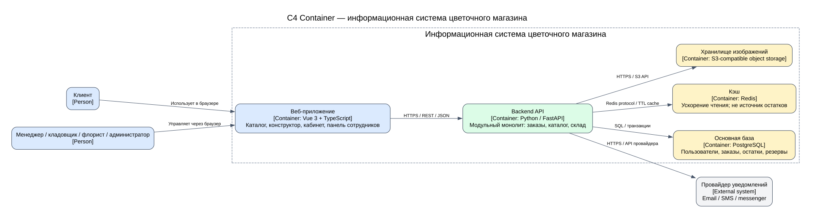
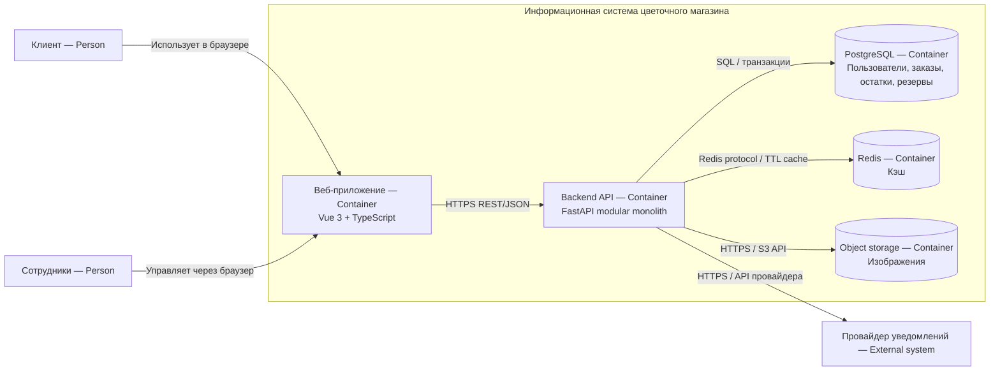
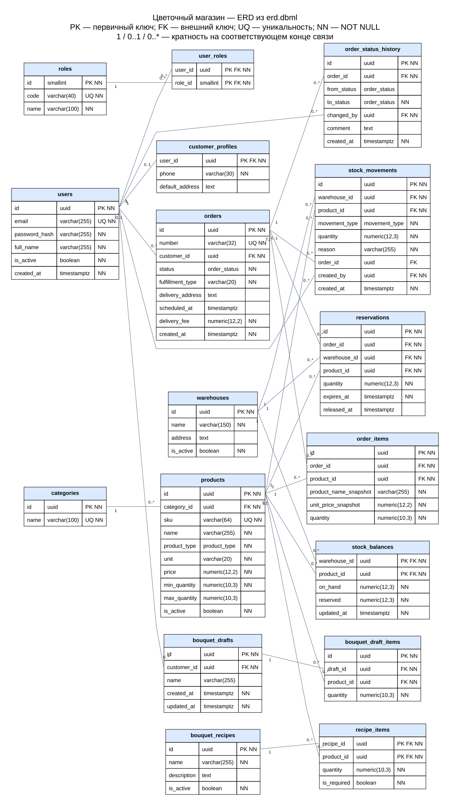

# Архитектура информационной системы цветочного магазина

## 1. Назначение проекта

Система автоматизирует прием и обработку заказов цветочного магазина, учет цветочной продукции и расходных материалов, а также создание индивидуальных букетов через интерактивный конструктор.

Клиент выбирает состав букета и дополнительные элементы. Система проверяет бизнес-правила и остатки, рассчитывает цену, временно резервирует необходимые позиции и создает заказ. Сотрудники магазина управляют каталогом, складом, заменами и статусами заказов.

## 2. Границы MVP

В первую версию входят:

1. каталог цветов, упаковки и дополнительных товаров;
2. конструктор букета;
3. расчет стоимости и проверка наличия;
4. регистрация клиента и оформление заказа;
5. статусы заказа и история изменений;
6. складские остатки, приемка и списание;
7. управление каталогом и заказами сотрудниками;
8. доставка или самовывоз.

За пределами MVP остаются программа лояльности, сложная аналитика, интеграция с несколькими службами доставки и автоматическое распознавание фотографий букетов.

## 3. Пользовательские роли

| Роль | Ответственность |
|---|---|
| Клиент | Собирает букет, оформляет заказ, выбирает способ получения и отслеживает статус. |
| Менеджер | Управляет каталогом, ценами, рецептами, заказами и заменами компонентов. |
| Кладовщик | Принимает поставки, корректирует остатки, резервирует и списывает товар. |
| Флорист | Просматривает состав заказа, собирает букет и фиксирует фактические замены. |
| Администратор | Управляет пользователями, ролями и системными настройками. |

## 4. Основные Use Cases

- UC-01: клиент создает букет, система проверяет состав и пересчитывает цену;
- UC-02: клиент оформляет заказ;
- UC-03: менеджер подтверждает заказ или согласует замену;
- UC-04: кладовщик проводит складскую операцию;
- UC-05: флорист собирает букет;
- UC-06: клиент или менеджер отменяет заказ.

Просмотр каталога входит в сценарий создания букета. Уведомления и управление ролями описаны как планируемые функции; их API не входит в контракт лабораторной №2.

Подробные сценарии приведены в [docs/use-cases.md](docs/use-cases.md).

## 5. REST API Specs

Базовый URL локального сервера: `http://localhost:8000/api/v1`. Для защищенных запросов используется заголовок `Authorization: Bearer <JWT>`.

| Метод | URI | Назначение | Доступ | Код |
|---|---|---|---|---|
| POST | `/auth/register` | Регистрация клиента | Все | 201 |
| POST | `/auth/login` | Вход и получение JWT | Все | 200 |
| GET | `/auth/me` | Текущий пользователь | Авторизованные | 200 |
| GET | `/products` | Список товаров с фильтрами | Публичный | 200 |
| POST | `/products` | Создание товара | Менеджер, администратор | 201 |
| GET | `/products/{productId}` | Карточка товара | Публичный | 200 |
| PATCH | `/products/{productId}` | Изменение товара | Менеджер, администратор | 200 |
| DELETE | `/products/{productId}` | Архивирование товара | Менеджер, администратор | 204 |
| GET | `/bouquet-drafts` | Черновики букетов клиента | Клиент | 200 |
| POST | `/bouquet-drafts` | Создание черновика букета | Клиент | 201 |
| GET | `/bouquet-drafts/{draftId}` | Получение черновика | Владелец | 200 |
| POST | `/bouquet-drafts/{draftId}/items` | Добавление компонента | Клиент | 201 |
| PATCH | `/bouquet-drafts/{draftId}/items/{itemId}` | Изменение количества | Владелец | 200 |
| DELETE | `/bouquet-drafts/{draftId}/items/{itemId}` | Удаление компонента | Клиент | 204 |
| POST | `/bouquet-drafts/{draftId}/validations` | Проверка состава, наличия и цены | Владелец | 200 |
| GET | `/orders` | Список заказов | Клиент — свои; менеджер, флорист, администратор — все | 200 |
| POST | `/orders` | Создание заказа и резервирование | Клиент | 201 |
| GET | `/orders/{orderId}` | Получение заказа | Владелец, менеджер, флорист, администратор | 200 |
| PATCH | `/orders/{orderId}/status` | Изменение статуса заказа | Менеджер, флорист, администратор | 200 |
| POST | `/orders/{orderId}/cancellations` | Отмена заказа и освобождение резерва | Владелец, менеджер, администратор | 200 |
| GET | `/inventory/stock` | Просмотр складских остатков | Кладовщик, менеджер, администратор | 200 |
| POST | `/inventory/movements` | Приход или списание | Кладовщик, администратор | 201 |

Полная спецификация OpenAPI 3.0.3 находится в корне репозитория: [openapi.yaml](openapi.yaml).

Всего в таблице 22 операции. Черновики доступны только владельцу; чужой UUID дает 404. Просмотр активного каталога не требует JWT; просмотр архивных товаров разрешен менеджеру и администратору. Для защищенных операций 401 означает отсутствие действительного JWT, 403 — нехватку прав, 404 — отсутствие ресурса, 409 — конфликт состояния или нехватку остатков, 400 — некорректные входные данные.

Swagger UI служит для демонстрации контракта. Страница запускается по инструкции в README; исполняемый backend в лабораторных №1–2 не реализуется.

## 6. Функциональные требования

| ID | Требование |
|---|---|
| FR-01 | Система хранит каталог компонентов с названием, категорией, единицей измерения, ценой и признаком активности. |
| FR-02 | Система показывает доступный остаток с учетом уже зарезервированных позиций. |
| FR-03 | Конструктор позволяет добавлять и удалять компоненты и изменять их количество. |
| FR-04 | Конструктор проверяет минимальные и максимальные количества, совместимость и доступность. |
| FR-05 | Цена пересчитывается после каждого изменения состава. |
| FR-06 | При оформлении заказа система создает резерв на ограниченный срок. |
| FR-07 | Заказ содержит снимок состава и цены на момент оформления. |
| FR-08 | Система ведет историю статусов и складских операций. |
| FR-09 | Сотрудник может заменить недоступный компонент только на разрешенный аналог. |
| FR-10 | Доступ к операциям определяется ролью пользователя. |

## 7. Нефункциональные требования

- все изменения остатков выполняются транзакционно;
- API использует HTTPS и JWT-сессии;
- пароли хранятся только в виде безопасных хэшей;
- запросы к каталогу и остаткам имеют индексы по внешним ключам и часто используемым полям;
- операции с заказами и складом журналируются;
- API должно возвращать понятные ошибки валидации;
- система должна корректно работать на мобильной ширине экрана;
- резерв заказа автоматически освобождается после истечения срока или отмены.

## 8. Архитектурный стиль

Для MVP выбирается модульный монолит. Один backend разворачивается как приложение, но бизнес-функции разделены на модули: Auth, Catalog, Bouquet, Order, Inventory, Notification и Admin.

Такой вариант уменьшает стоимость разработки и упрощает транзакции между заказом и складом. Выделение отдельных сервисов может быть рассмотрено после появления реальной нагрузки.

## 9. C4 Container

Пользователи находятся вне границы системы. Веб-приложение, Backend API, PostgreSQL, Redis и хранилище изображений — ее контейнеры; провайдер уведомлений — внешняя система. Источник SVG — [c4-container.dot](docs/diagrams/c4-container.dot), альтернативная запись — [c4-container.mmd](docs/diagrams/c4-container.mmd). Резервы хранятся в PostgreSQL; Redis используется как кэш.

## 10. Основные модули backend

| Модуль | Ответственность |
|---|---|
| Auth | Регистрация, вход, JWT, роли и права. |
| Catalog | Цветы, упаковка, дополнительные товары, категории и цены. |
| Bouquet | Черновик букета, совместимость, расчет цены и состава. |
| Order | Корзина, заказ, статусы, доставка и история изменений. |
| Inventory | Остатки, резервы, приход, списание и перемещения. |
| Notification | Уведомления о создании заказа и изменении статуса. |
| Admin | Пользователи, настройки и аудит действий. |

## 11. Данные

Основные сущности: `User`, `Role`, `UserRole`, `CustomerProfile`, `Product`, `Category`, `Warehouse`, `StockBalance`, `StockMovement`, `BouquetRecipe`, `RecipeItem`, `BouquetDraft`, `BouquetDraftItem`, `Order`, `OrderItem`, `OrderStatusHistory`, `Reservation`.

Полная ER-схема находится в [docs/diagrams/erd.dbml](docs/diagrams/erd.dbml), описание модели — в [docs/domain-model.md](docs/domain-model.md).

ERD содержит 17 таблиц и 23 связи, сгенерированные непосредственно из DBML. `users` и `customer_profiles` связаны как 1 к 0..1; `user_roles` и `recipe_items` реализуют N:M. Кратность подписана на каждом конце связи. Исходник Graphviz — [erd.dot](docs/diagrams/erd.dot). Для подробного просмотра откройте SVG отдельно и увеличьте масштаб.

Ответы на контрольные вопросы находятся в [docs/control-questions.md](docs/control-questions.md).

## 12. Трассировка требований лабораторной работы

| Требование лабораторной работы | Артефакт |
|---|---|
| Минимум две роли и Use Cases | Разделы 3–4 и `docs/use-cases.md` |
| Минимум пять сущностей | Раздел 11 и `docs/diagrams/erd.dbml` |
| C4 Container | Раздел 9 и `docs/diagrams/c4-container.mmd` |
| ERD в 3NF | `docs/diagrams/erd.dbml` |
| README и ARCHITECTURE | `README.md` и этот файл |
| REST API таблица | Раздел 5 «REST API Specs» |
| OpenAPI 3.0 спецификация | [`openapi.yaml`](openapi.yaml) |
| Контрольные вопросы лабораторной №2 | [`docs/control-questions-lab2.md`](docs/control-questions-lab2.md) |
